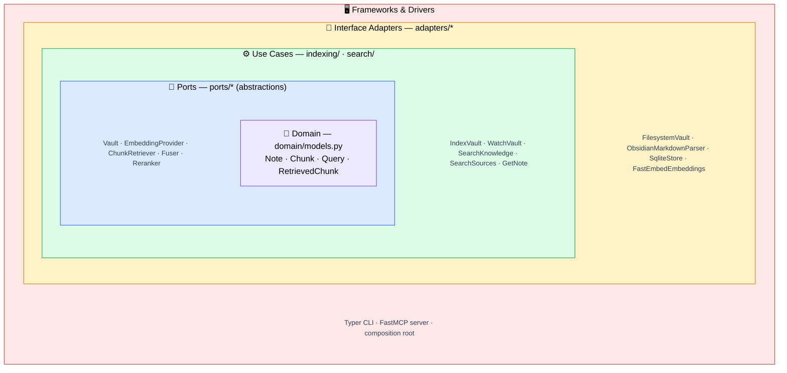

# Learning journey

Ariostea is a personal learning project: a RAG pipeline (hybrid retrieval, contextual
retrieval, cross-encoder reranking) built from scratch with few dependencies, on a strict
Clean Architecture skeleton. This page covers how it is built and how each stage was measured.
The [README](README.md) covers installing and using it.

## How it is built

Ariostea follows Clean Architecture. Source-code dependencies point only inward, toward the
more abstract and more stable code. The domain has no framework imports, use cases depend on
ports (Protocols) rather than concrete adapters, and every concrete detail, SQLite, the
embedding model, the MCP framework, is wired in one place, the composition root
`config/container.py`.



Each layer may depend only on the layers inside it. The innermost `domain` knows nothing
about anything outside it, and the outer shell knows about everything.

What this buys:

- The vault, the embedding model, store, fusion, reranking and contextualisation all sit
  behind ports.
  Swapping the English embedding model for a multilingual one, or adding the whole BM25 + RRF
  + reranking stack, touched no use-case code.
- Use cases run against in-memory fakes, so the fast test suite needs no SQLite file and no
  model download.
- `config/container.py` is the only module that imports concrete adapters, and it injects
  each one into a use case as its narrow role.

A search runs dense retrieval and BM25 in parallel, RRF fuses them into a high-recall pool,
and a cross-encoder reranker picks the final results by query-passage relevance.

[ARCHITECTURE.md](ARCHITECTURE.md) covers every port and adapter, the indexing and search
flows, the config-fingerprint guard, and the reason for each ranking stage.

## How it was measured

The pipeline was built first and measured after. Each stage (hybrid retrieval, reranking,
contextual retrieval) is a known technique, and the question was whether it holds up on real
material. Answering it needed an evaluation that can detect a change of a few cases. Every
recall figure below comes from `eval/results/runs.jsonl`. The full account, with every figure
and the reproduction commands, is in [docs/retrieval-tuning.md](docs/retrieval-tuning.md).

## The instrument

`eval/wiki/` holds 79 Wikipedia articles in 6 topic clusters (board games, cheese, coffee,
cycling, sailing, string instruments), pinned to revision IDs so the snapshot rebuilds byte
for byte. Articles in a cluster share vocabulary, so every query has near misses to reject.
The snapshot is rebuilt with:

```bash
uv run python eval/build_wiki_corpus.py   # re-fetches every pinned revision
```

The revision IDs are in `eval/wiki/clusters.json`.

`eval/wiki/gold.json` holds 167 queries over that corpus. Each points at the text span that
answers it, not just the note, and a retrieved chunk counts as a hit only when it contains the
whole span. The labels stay valid under any chunking policy, which is what made chunking
measurable at all.

| type | stresses | cases |
|---|---|---|
| paraphrase | dense embeddings | 40 |
| exact_term | BM25 full-text search | 41 |
| buried | facts deep inside a long section | 40 |
| cross_lingual | Italian and Spanish queries over English articles | 46 |

The set is LLM-generated. A local model wrote candidates from 505 passages, a different model
judged them, and they passed five gates: span verification, the adversarial judge, a filter
dropping queries every channel already answers at rank 1, an ambiguity gate, and a human spot
review. 338 candidates were rejected, each with its reason in `eval/wiki/gold_rejected.json`.

Every run goes into `eval/results/runs.jsonl` with its configuration, commit and every metric
per channel and query type, compared against a named control. `eval/results/experiment_log.html`
renders the log as a table shaded green for gains and magenta for losses, grey within ±0.03,
the smallest change 167 queries can resolve, about 5 cases.

A decision rule was fixed before any result was in. A change replaces a default only if hybrid
span recall gains at least 0.03, no query type loses more than 0.05, and at least 160 of 167
answers stay reachable.

## Baseline

Span recall at k=5 with the original chunking, 512 words with no overlap:

| channel | span recall | cross_lingual |
|---|---|---|
| dense | 0.335 | 0.391 |
| sparse (BM25) | 0.605 | 0.022 |
| hybrid (fused, reranked) | 0.832 | 0.630 |

Hybrid is what the server serves. Dense at 0.335 was far too low for a multilingual embedding
model on this material.

## Trial 1: chunking

Measuring what the embedding model reads explained the dense number. The size cap counted
words, the model counts subword tokens, and Italian and Spanish run well over one token per
word. 299 chunks, 1 in 5, were longer than the model's 512-token input, and fastembed
truncates silently, so the dense channel embedded only the start of those. 15 answers sat past
the cut, unreachable by dense retrieval at any rank.

The fix was to size chunks in model tokens, with overlap so no answer is cut in half. A sweep
of 9 policies ran dense and sparse first, then hybrid for the 3 best, then a confirmation run,
then the same again with the reranker switched off.

| policy | dense | hybrid | hybrid cross_lingual | fused (no reranker) |
|---|---|---|---|---|
| 512 words (control) | 0.335 | 0.832 | 0.630 | 0.551 |
| 160 tokens, overlap 40 | 0.545 | 0.880 (+0.048) | 0.696 | 0.629 (+0.078) |


160 tokens with 40 of overlap was the only policy that passed the rule with the reranker and
without it, and it became the default until Trial 4 moved to 256 tokens with 64. The hybrid gain is probably smaller than +0.048, since
the neighbouring policies gained +0.006 to +0.018, so part of it is luck. Without the reranker
the gain is large and steady, +0.06 to +0.09 for every policy, because the reranker had been
absorbing most of the damage the word cap did. The change is a fix for silent truncation more
than a tuning win, and upgrading re-chunks and re-embeds a vault once.

## Trial 2: note-level blurbs

Contextual indexing asks an LLM for one short blurb per note, its topic and key entities, and
prepends it to every chunk before embedding and indexing. On the earlier eval corpus, 19 short
documents of one chunk each, it had lifted dense and sparse retrieval, while hybrid stayed
flat because the reranker scored the raw chunk. The trial asked two questions: do blurbs help
on the wiki set, and does letting the reranker see them help hybrid.

| configuration | dense | hybrid | hybrid cross_lingual |
|---|---|---|---|
| no blurbs (control) | 0.545 | 0.880 | 0.696 |
| blurbs, reranker scores the raw chunk | 0.503 | 0.844 (−0.036) | 0.609 |
| blurbs, reranker scores blurb and chunk | | 0.814 (−0.066) | 0.609 |

Both fail the rule, so blurbs stay off, and the dense channel shows why. Note recall went up,
0.826 to 0.850, so the blurb helps find the right article. Span recall went down, and on the
29 cases the gold set had dropped as too easy it fell from 0.931 to 0.759. A wiki article here
is dozens of chunks that all carry the same blurb, so their vectors move toward each other and
the right chunk is harder to pick out of its own article. The earlier lift came from one-chunk
notes, where that cannot happen.

## Trial 3: per-chunk context

Anthropic's Contextual Retrieval writes the context per chunk instead. The prompt holds the
whole document and one chunk, and asks for a short text that situates that chunk. Every chunk
gets a different context, which targets the convergence above. All 4,246 chunks got one, from
a local `qwen2.5-7b-instruct` in three and a half hours. The 14B model at a 32k context ran
the Mac out of GPU memory and panicked it on both attempts.

| configuration | dense | fused (no reranker) | hybrid | hybrid cross_lingual |
|---|---|---|---|---|
| no context (control) | 0.545 | 0.629 | 0.880 | 0.696 |
| per-chunk context, reranker scores the raw chunk | 0.581 (+0.036) | 0.665 (+0.036) | 0.850 (−0.030) | 0.630 |
| per-chunk context, reranker sees the context | | | 0.856 (−0.024) | 0.652 |

It fixes what the blurbs broke. Dense goes up instead of down, the easy cases stay at 0.931,
and every stage before the reranker gains. The gain does not survive the reranker. The
cross-encoder already reads chunk and query together, so the context adds little it lacks,
and the changed candidate pool costs a few cases, 3 of them cross-lingual. Hybrid fails the
rule either way, so contextual indexing stays off. The per-chunk option stays in the code for
a setup without a reranker, where it gains +0.036.

## Trial 4: the embedding model

Cross-lingual was the one weak type, and BM25 finds 1 of its 46 cases, so dense retrieval is
the only first-stage channel that works there. Three newer multilingual models were measured
against the one every earlier run used, all at 160 tokens with overlap 40.

The first run turned up a problem older than the trial. The vector store ranks by Euclidean
distance, and fastembed returns unnormalised vectors for the old model, so every dense number
above had ranked raw vectors, not by the cosine similarity the model was trained for. A new
setting, `embedding.normalize`, scales vectors to length 1, and the trial measured it as its
own factor.

Hybrid hits out of 167, cross-lingual out of 46:

| configuration | dense | hybrid | hybrid cross_lingual | one query |
|---|---|---|---|---|
| previous model, raw vectors (control) | 0.545 | 147 | 32 | 4.8 ms |
| previous model, unit vectors | 0.593 | 150 | 35 | 4.9 ms |
| `intfloat/multilingual-e5-large` | 0.778 | 154 | 39 | 14.7 ms |
| `jinaai/jina-embeddings-v3` | 0.832 | 155 | 41 | 116.3 ms |
| `BAAI/bge-m3` | 0.856 | 155 | 41 | 14.3 ms |
| `BAAI/bge-m3`, 256 tokens, overlap 64 | 0.880 | 157 | 41 | 15.2 ms |

Normalisation alone gains 3 cases and fails the rule. bge-m3 and jina-v3 gain 5 over the
normalised control, which is 0.0299 against a rule written as 0.03 but set as "about 5
cases". The reading was settled after the data, as 5 cases, so both pass. bge-m3 won on
cost: the same recall as jina-v3 at an eighth of the query time, under MIT where jina-v3 is
non-commercial. The 160-token chunks had been sized for the old model's 128-token training,
so the trial measured bge-m3 at 256 tokens too, and it found 2 more cases with no type worse.

Switching the default exposed two upgrade bugs on a real vault. An existing index could not
take vectors of a new size, and an index built before the late-September blurb work lacked a
column the store now writes. Both broke the next reindex. The store now rebuilds the vector table and adds missing
columns when it opens.

## Trial 5: search speed

A search took about 2.5 s on a 50-note vault and 4.0 s at the median on the eval set, nearly
all of it in the reranker. Its cost grows with the number of candidates it scores and with
their length: jina took about 46 ms per 256-token candidate on this Mac, and it scored 100.

The decision rule above is for changes meant to gain recall. This trial traded a little recall
for time, so it fixed its own bar before the runs: a 95th percentile under 1 s on the eval set,
at least 155 of 167 hits, and no query type more than 2 cases down on the control. It turned
two knobs: the pool, the number of fused candidates the reranker scores,
and the model. A quantised jina was no faster, so the second model is
`cross-encoder/mmarco-mMiniLMv2-L12-H384-v1`, a multilingual cross-encoder under Apache 2.0,
0.47 GB against 1.1 GB.

Each of the 167 queries was timed through the production search path, after one warm-up
query. Hits out of 167, cross-lingual out of 46; the last column counts the queries for which
`search_sources` returns fewer than 10 notes at k=10:

| reranker, pool | hybrid | hybrid cross_lingual | span MRR | median | 95th percentile | `search_sources` short |
|---|---|---|---|---|---|---|
| jina, 100 (control) | 157 | 41 | 0.867 | 4009 ms | 4623 ms | 54 |
| jina, 50 | 156 | 41 | 0.862 | 2340 ms | 2426 ms | 35 |
| jina, 30 | 157 | 42 | 0.863 | 1585 ms | 1634 ms | 101 |
| jina, 20 | 151 | 41 | 0.844 | 1146 ms | 1199 ms | 153 |
| mMiniLM, 100 | 154 | 38 | 0.828 | 1628 ms | 1942 ms | 36 |
| mMiniLM, 50 | 154 | 38 | 0.831 | 1003 ms | 1059 ms | 35 |
| mMiniLM, 30 | 156 | 40 | 0.833 | 576 ms | 707 ms | 101 |
| mMiniLM, 20 | 153 | 42 | 0.824 | 360 ms | 418 ms | 153 |

Only mMiniLM at pool 30 passes both bars. jina stays above 1 s even at pool 20, where it also
drops to 151 hits, and mMiniLM at pool 50 misses the time target by 59 ms. The new default
costs 1 hit and some ranking quality: span MRR falls from 0.867 to 0.833, so the right passage
sits lower in the top 5 more often. On the 50-note vault, an Italian query about blossom-end
rot in tomatoes finds the tomato note second, where jina put it first.

The `search_sources` column follows the pool. That tool groups at most 50 reranked passages by
note, so at pool 30 it has 30 to group, and many queries come back with fewer than 10 notes.
At pool 100 it gets the reranker's best 50 of 100, which sit on fewer notes than the 50 of a
pool of 50.

## The defaults today

`BAAI/bge-m3` embeddings, 256-token chunks with 64 of overlap, the
`mmarco-mMiniLMv2-L12-H384-v1` reranker on with a pool of 30, contextual indexing off. bge-m3
returns unit vectors itself, so `normalize` stays off. Hybrid span recall is 0.934, 156 of
167, against 0.880 before Trial 4 and 0.832 at the baseline. Cross-lingual is 0.870, 40 of 46.

bge-m3's cost is a larger model: a 2.27 GB download against 1 GB, about three times the indexing
time, and 15 ms to embed a query against 5. That figure is query embedding alone; a whole
search, reranker included, takes about 0.6 s (see Memory and speed in the
[README](README.md#memory-and-speed)). With dense retrieval this
strong, fusing in BM25 now lowers the first stage on cross-lingual queries, and the reranker
hides it. That, and the 11 cases still missed, are the next things to look at.
